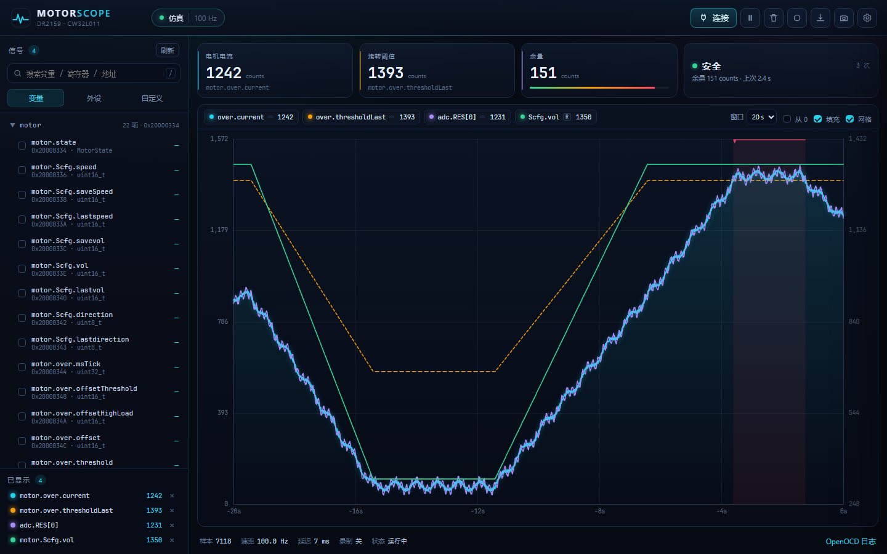
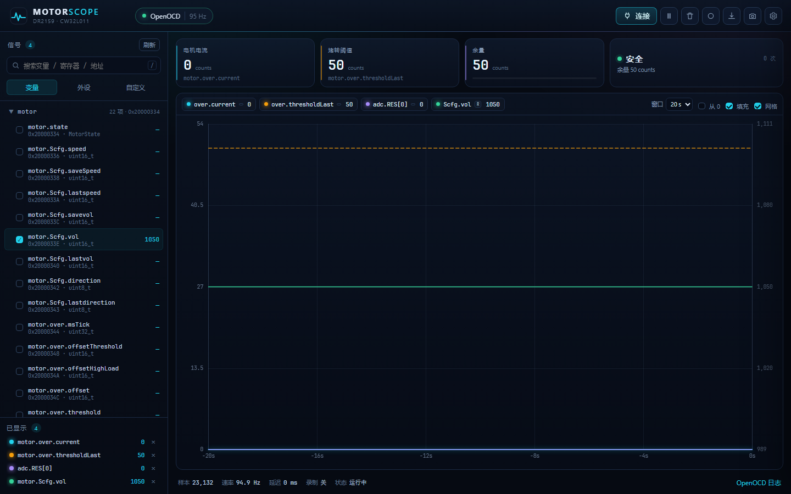
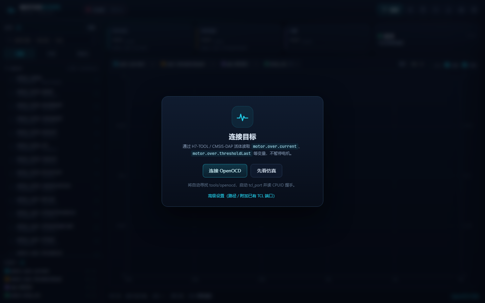
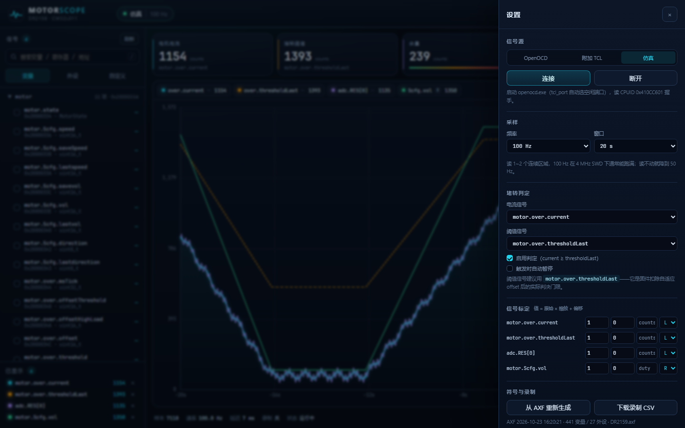

# MotorScope · 多机型波形台

> 用 OpenOCD **活体**读目标 RAM / 外设寄存器，在浏览器里画时间轴波形。
> 内置 **DR2159（CW32L011）**、**DR1152（CW32L012）**、**DR1152_CH（CH32V203）**、
> **LKS32-FOC（LKS32MC07x）** 四套机型工程，一键切换符号表 + 芯片 + 连接参数。
> 默认只读：不 halt、不 reset、不烧录；写入是显式解锁后的可选动作，
> 仅限 RAM / SFR，写后立即回读。



实机连接（电机未启动时 `current=0`；`thresholdLast=50`、`vol=1050`）：



---

## 1. 它是怎么工作的

```
浏览器 UI  ──HTTP / SSE──▶  scope_server.py  ──Tcl RPC(tcl_port)──▶  openocd.exe
                                   │                                      │
                                   │  AXF/DWARF + map + cw32l011.h        │ SWD
                                   ▼                                      ▼
                              signals.json                          H7-TOOL → CW32L011
```

- 服务器启动一个 `openocd.exe`，只开 `tcl_port`（telnet/gdb 都关掉），
  用 Tcl 的 `read_memory` 原语读目标内存。
- 每轮采样把所有信号归并成 **尽量少的连续块**，一条 Tcl 命令一次读完；
  不调用 `halt`，电机可以边跑边看。
- 浏览器只收原始整数，缩放/单位/左右轴都在前端改，改标定不用重采样。
- 没有硬件时切到“仿真”源，UI、堵转判定、录制、CSV 全部可以演示。

---

## 2. 快速开始

> **免安装**：本目录自带 `runtime\python`（CPython 3.13.3 + pyelftools，Windows x64），
> 不需要另装 Python；`start_scope.bat` 会优先用它。整个目录拷到别的机器即可运行，
> 详见 [runtime/README.md](runtime/README.md)。

### 2.0 依赖准备（clone 后做一次）

主仓**不含** OpenOCD 二进制（GPL / 体积原因），只含 submodule 指针与查找逻辑：

```sh
git clone <本仓库> && cd motor-scope
git submodule update --init --recursive     # 拉取 cfg 存档 + WCH 源码
python tools/fetch_openocd.py               # 下载 RISC-V 预编译包 + 检查 ARM 安装
```

- **RISC-V（CH32）**：`fetch_openocd.py` 从
  [riscv-openocd-wch 的 Release](https://github.com/Huyil/riscv-openocd-wch/releases)
  下载预编译包并解压到 `tools/openocd-wch-fast/`（含 `openocd.exe` / `openocd-linux-x64`）。
  GitHub 直连不稳时：`MOTORSCOPE_RISCV_ZIP=<本地zip> python tools/fetch_openocd.py`
- **ARM（CW32 / LKS32）**：脚本只检查 `tools/openocd/`。没有就把一份
  [OpenOCD 0.12.0](https://github.com/openocd-org/openocd) 发行版放进去
  （需 `bin/openocd.exe` + `share/openocd/scripts/`），或在信号源面板填「OpenOCD 根目录」。
- **target cfg**：由 submodule [`motor-scope-openocd-cfg`](https://github.com/Huyil/motor-scope-openocd-cfg)
  提供；`ocd.py` 在二进制包缺 `bin/wch-riscv.cfg` 时会自动取
  `tools/openocd-cfg/target/ch32-riscv.cfg`。

只想检查当前状态：`python tools/fetch_openocd.py --check`

### 2.1 有硬件

前提：

1. 目标板得电（SWD 不给板子供电）；
2. H7-TOOL 接 SWD：`PA13=SWDIO`、`PA14=SWCLK`，排线方向正确；
3. **没有别的调试器占着 H7-TOOL**（Keil 下载/调试、另一个 openocd 都要先退出）。

然后：

```bat
start_scope.bat
```

它会：

1. 启动 `scope_server.py`，打开 `http://127.0.0.1:8765/`（本地端口被占用会自动 +1，看控制台）；
   **默认只监听 127.0.0.1，局域网共享关闭**；
   DSH 侧栏面板的“局域网共享”会启动**独立 TCP 转发器**（不重启服务）：
   先开主共享（首次会弹 Windows 防火墙，显示 `http://192.168.x.x:<端口>/`），
   再按需开可选的“80 端口”（`http://192.168.x.x/`，需管理员）；
   手动/命令行也可用 `--host 0.0.0.0` 直接监听普通端口；
2. **不自动连接**：页面停在“待连接 · 待运行”，点顶栏 **“连接”** 或信号源卡片后才启动 OpenOCD；
3. 连接时**只在工程 `tools/openocd/` 下找** OpenOCD（ARM 用 0.12.0-rc2，
   RISC-V 用 `tools/openocd-wch-fast/`），选空闲端口起 `openocd.exe`
   （`tcl_port` + 关 telnet/gdb），再读 CPUID/芯片 ID 握手。
   如需用别的安装，在信号源面板填「OpenOCD 根目录」自定义路径，或用 `--openocd`；
   代码不再扫描任何写死的绝对路径。

启动参数可以覆写，例如：

```bat
start_scope.bat --port 8790 --rate 50
```

### 2.2 没硬件 / 只想看 UI

```bat
start_scope_sim.bat
```

或者在连接卡片上点 **“先看仿真”**。仿真是一个 30 秒循环：
升速 → 加负载跨阈值 → 卸载 → 巡航 → 降速，首尾连续，不会在窗口里跳变。

### 2.3 切换机型（DR2159 / DR1152 / DR1152_CH / LKS32-FOC）

顶栏“工程配置”卡片打开后有四张机型卡，点一下即可切换：

- 每张卡带 **MCU、变量/外设数量、`●` 当前机型**；
- 切换会换用 `profiles/<机型>/signals.json` 并断开当前调试源（地址整体变了，
  换板/换固件后请重新点“连接”）；
- 面板里还有 **保存配置**（写 `profiles/<机型>/config.json`）和
  **重建当前机型符号**（按该机型源 AXF/SVD 重新生成）；
- 详细目录结构、字段、LKS 识别方式和新增机型步骤见 **[profiles/README.md](profiles/README.md)**。

### 2.4 已经有 openocd 在跑

如果手工起的 openocd 已经开了 `tcl_port 6666`：

```bat
python scope_server.py --attach 127.0.0.1:6666 --open
```

---

## 3. 界面



- **左栏 · 变量**：从 AXF 的 DWARF 里抽出来的 RAM 变量/结构体字段/位域，
  按 `motor`、`adc`、`sys` 等对象分组；搜索支持名字/地址。
- **左栏 · 外设**：`ADC`、`ATIM`、`GTIM1/2`、`GPIOA/B/C`、`SYSCTRL`……
  寄存器按 `TypeDef` 展开；点 `+` 看位域（`ADC.CR.EN` 这种）。
- **左栏 · 四键**：每行右侧是 2×2 的 `表 / 波 / 写 / 读`：
  `表` 加入数值表，`波` 加入波形，`写` 加入下方写入窗口，
  `读` 只读一次并刷新该行的 `sig-val` 和简述（不加入采样）。
  添加 `表/波` 是**追加**：已有曲线/历史保留，新通道从当前时刻接着画，不整屏重置。
- **点击整行**只展开/收起详述（地址/类型 + 手册完整描述），**不再**加入波/表；
  波/表/写/读都只在右侧四键里按。
- 寄存器行按 **读**：一次读回该寄存器的 word，同时刷新它下面所有位域的
  `sig-val` 和简述（不额外读、不加入采样）；折叠着的位域也会缓存，展开即显示。
- 外设大标题右侧有独立的 **读** 按钮：连续读该外设全部寄存器一次（读队列），
  适合 ADC/MCPWM/GPIO 这种整组寄存器一起刷新的场景；标题同时显示中文名
  （如 `ADC` = 模数转换器）。
- **树视图暂时下线**，`列表 / 树` 的“树”按钮保留（禁用），后续替换；
  `view-row` 右侧有 **“全部收起”**，一键收起所有分组、外设、寄存器位域和行详情。
- 列表始终以 `cat-group-head` 分组展示，不再有裸的 `sig-item`；分组/外设/寄存器/位域
  用不同字体颜色区分（青 / 蓝 / 浅蓝 / 紫），`reg-toggle` 加大到 20×20 并带悬浮高亮。
- 长变量名（>24 字符）按第一个 `.` 拆成两行，例如
  `poweronbreakhandle` / `.power_on_break_flag`；寄存器/位域显示 `.CFG` / `.TBS`，
  用前导点表示层级。相邻分组标题用青/紫两套淡底色交替，便于区分边界。
- **行内简述**：变量/寄存器行第二行显示该寄存器的手册简述；有位域状态的
  （bool 的 0/1、枚举值的含义）在点 `读` 后切换成当前值的描述；
  如果开了波/表，只显示静态简述，避免每个采样都刷新。
- **左栏 · 自定义**：直接填 `0x20000344` + 长度 + 有无符号，读任意地址。
- **左栏 · 波形**：第 4 个标签，管理波形分组：
  - 默认分组内的每一路**独立显示、独立 Y 轴**（每个 pane 一套刻度）；
  - 把行**拖进同一个自定义分组**，组内波形共享一套坐标轴；
  - 组头 `◉ / ○` 可单独显示/隐藏分组，默认分组也能隐藏；
  - `+ 新建分组` 创建共享轴组，`×` 删除组时组内波形回到默认分组。
- **顶部卡片**：工程 / 录制 / 信号源 / 采样率。采样率卡显示目标值与实际值、
  每轮耗时，底部进度条是**占用率**（一轮读内存的耗时 ÷ 目标周期；100% 表示刚好读得过来，
  超过就说明探针已经到顶、实际速率会低于设定值）。
- **中栏**：时间轴波形。每个可见分组占一个 pane；默认每路独立轴，自定义组共享轴；共享组内也按每行自己的换算/单位绘制（未设置的行按原始值），有换算/单位的通道在图例左侧标 `※`；
  图例里带 `R` 的仍走右侧 Y 轴刻度。
- **波形游标**：在波形区**左键单击**可固定一个 `PIN` 时间游标，显示该时刻的竖线和数值悬浮窗（内容与鼠标悬浮一致）；再次左键移动，右键或 `Esc` 取消。
- **数值表 / 写入表**：同一行 **1 : 2** 两列（写入表 2 倍宽）；窗口变窄时优先压缩写入表，
  820px 以下自动上下堆叠。数值列按约 6 位数字宽排，带千分位逗号；
  超长数字换行并用更小字号挤在同一行高内。
- **顶部**：连接、暂停/继续、**复位**（SWD SYSRESETREQ）、清空、录制、CSV、截图、设置；最右侧是缩小的
  SWD 占用指示（信号源 + 实际速率），窄屏自动隐藏速率。
- **底部**：样本数、实际速率、延迟、录制状态、OpenOCD 日志。



设置里可以：

- 切换信号源（OpenOCD / 附加 TCL / 仿真）、填 OpenOCD 根目录或已有 TCL 端口；
- 改采样率（1–300 Hz；RISC-V 读取要 halt，上限 50 Hz）；
- 指定“电流信号”和“阈值信号”，开/关堵转判定、触发时自动暂停；
- 给每路信号填 `缩放 / 偏移 / 单位 / 左轴L或右轴R`；
- 从 AXF 重新生成符号表、下载后端录制 CSV。

### 3.1 写入窗口（横条 + 方块，多模块，默认未解锁）

数值表右侧（1 : 2 双列）的“写入”卡片是一个**多模块**窗口；默认高度与旁边的数值表卡对齐，展开详情后自动加高（最高约 60vh），列表内部滚动。
模块分两种样式：**横条在顶部、方块在底部**，样式可在展开的“数值设置”里切换：

- **从左侧添加**：点任意信号行的 `写` 即加入写入窗口，**同时加入“已选择”**；再点一次或点模块右上角 `×` 取消写入。
- **“已选择”里的 `写` 勾选**：已选择行的 `表 / 波 / 写` 三个开关中，`写` 控制该行是否加入写入窗口；取消 `写` 后行仍保留在“已选择”（不会从监视集消失），需要移除请点行尾 `×`。
  只勾选 `写`、不勾 `表/波` 时不进入实时采样（只写不读，不占“信号/数值表”计数）；
- **横条样式**：占满整行，三行布局：
  - 第一行：寄存器名 + 位宽/地址 + 右侧当前值输入框；开关模式则是两个数值按钮；
  - 第二行：滑条铺满整行；
  - 第三行：左侧最小值、中间状态、右侧最大值。
- **方块样式**：卡片式，可设宽度 `1/3 → 1/2 → 整行`；滑条与当前值并排，
  下方是 min/状态/max，适合并排对比多个寄存器；
- **开关模式**：两个独立按钮，按钮上**只显示数值**（默认 `1 / 0`，不写“开/关”字样），
  点击即写入对应值，可重复点击写同一个值；两个值在展开窗里修改；
- **展开/收起**：每个模块右侧的 `▸ / ▾` 展开“数值设置”，包括：
  `条/块` 样式切换、`滑条/开关` 模式切换、`写入`、方块宽度、
  最小/最大/步长（滑条）或开值/关值（开关）。收起后只保留主操作；
  展开后卡片自动加高到约 60vh，写入列表内部滚动；收起后恢复与数值表对齐的高度；
- **锁定按钮在主行**（不在展开窗里）：默认不锁定——滑条拖动即写入（按住时每 100ms
  写一次，松开补发最终值），开关/数值按钮单击写一次；点击 `锁定` 后，模块会按当前值
  持续周期性写入（每 100ms 一次），再次点击 `锁定` 停止；
- **状态不闪**：锁定周期性写入时状态栏保持稳定，不会每 100ms 在“写入中…”和
  “已写…”之间横跳；锁定/拖动过程只用 `LOCK` 标签和琥珀色呼吸点表示。状态栏只在
  显式写入完成、松开滑条后的最终写完成、出错、解锁状态变化时更新；
- 默认带一个 `motor.over.threshold` 横条模块，可直接删掉换成别的寄存器；
- **允许写入**：全局解锁，必须手动勾选，**不会**跨刷新/工程切换保留；
  未解锁/未连接时按钮禁用并显示原因；
- **写入按钮/回读**：每个模块独立写当前值；成功后显示 `已写 X · 回读 X`，
  回读不一致标红并 toast；
- **安全边界**：只接受 1/2/4 字节、地址按宽度对齐、范围必须在
  `0x2000_0000..0x2000_2000`（RAM）或 `0x4000_0000..0x5000_0000`（SFR）；
  位域写入走读-改-写，保留同字其它位。未连接、未解锁、非法地址、写失败都会在
  模块状态 + toast 给出明确原因，不会抛未捕获异常。

> 写入会真实改变固件行为。改 `motor.over.threshold` 前先确认电机处于安全状态；
> 不要写读清零/读后触发类寄存器。

### 3.2 工程存档（多机型 + localStorage + 服务器快照）

顶栏和“设置 → 工程”共享同一份工程列表；每个工程绑定一个机型：

- 自动保存到浏览器 `localStorage`（`ms.projects.v2` + 当前 `ms.cfg.v2`），
  同时约 1.8s 防抖写一份到 `profiles/<机型>/config.json`（换浏览器也能恢复）；
  切换工程会恢复通道、窗口、标定、堵转判定、3 张监视卡和写入模块；
- 工程绑定机型；切到别的机型的工程会先切后端符号/芯片，再恢复界面配置；
- **新建（复制当前）**、**另存为**、**删除当前**、**导出 JSON**、**导入 JSON**；
- 工程名支持中文；重名会弹确认；导入非法 JSON / 非 MotorScope JSON 会提示错误且不切换；
- 切换工程会重新下发采样配置并刷新历史；SSE 保持连接；
- 出于安全，`armed` 不跨工程恢复（见 3.1）。

### 3.3 多客户端（同一调试器）

波形通过浏览器 `EventSource('/api/stream')` 的 HTTP/SSE（底层 TCP）传输，不是裸 TCP；
服务端 `ThreadingHTTPServer` 为每个客户端维护独立 SSE 队列。

- 单个调试器只有**一套共享采样配置**：任一客户端新增/移除监视信号、改采样率或标定参数，
  服务端会广播给所有在线客户端，大家同步成同一套“监视集”；
- **客户端标识 / 本地配置隔离**：每个标签页默认生成 `tab-<时间戳>-随机`（存 sessionStorage），
  localStorage 配置按这个客户端键隔离；新标签从最近一次配置 seed，不会再互相覆盖。
  需要固定身份时（例如 DSH）用 `?client=dsh`，或在本机执行一次
  `localStorage.setItem('ms.clientId','dsh')`，之后该浏览器固定使用 `dsh` 的独立配置；
- **端数不限制 3**：服务端 SSE/Hub 本身按客户端逐个队列，presence 编号复用空闲号，
  同时开 4 个以上客户端也可用；实际只受浏览器/服务器资源限制；
- 新客户端连上时采用服务器当前共享配置，**不会**用本地存档覆盖别人的配置；
- 波形/数值表的 `表/波` 开关是**每个窗口自己的显示状态**：隐藏某一路不会改变采样集，
  也不会影响另一个客户端；所有客户端仍然接收全部监视通道的数据；
- **“已选择”页显示服务器的共享监视集**：所有客户端看到同一份列表；`表/波` 开关只决定
  本端是否显示，隐藏的行仍留在列表里（变淡），仍继续采样；
- **删除提示**：在“已选择”里点 `×` 会先确认；如果其他客户端正在查看该信号，会提示
  “正在被客户端 2 查看”。确认后从共享监视集移除并广播给所有客户端；
- 每端每 5s 上报一次本端显示集合和**分组布局**（`POST /api/view`：`visible` + `layout`），
  服务端保留 15s；页头显示在线端数，被其他端查看的行带“其他端 N”小标签；
- **查看/复制其他端布局**：`已选择` 页有“其他端布局”折叠面板，可展开看到对方的
  分组名、独立/共享轴、隐藏状态、每组行数和示例信号；点“复制到本窗口”会把
  分组、行归属、表/波显示开关、左右轴和**写入模块**一键复制到本端预览（只影响本端，
  不改变共享监视集，也不会推给其他端；写入模块复制后保持未锁定，需重新解锁）；
- **分享链接**：`已选择` 页点 `分享` 生成短链（`#share=<id>`）。打开链接会
  **自动应用一次**分享者的监视集、分组/行归属、表/波显示、左右轴、时间窗口、图表开关
  和**写入模块**（机型不同会先尝试切换机型；写入模块保持未锁定）；之后不再持续跟随，重新打开/刷新链接会再应用一次。
  分享快照持久化在 `imports/shares.json`（已 gitignore，30 天 / 最多 200 条）。
- 已知限制：数组 AVG 虚拟行的定义仍是本地的；写入模块已随“已选择”布局/分享快照复制，
  但多客户端之间的写入面板不做持续实时同步（要同步请用分享链接/复制布局）。

> 实测：A 先连（2 路），B 后连（`clients=2`）会直接采用 A 的 2 路配置并收到 2 列样本；
> B 新增 1 路后，A/B 都收到 `config` 事件并切到 3 列；B 隐藏一路不影响 A 的采样。

---

### 3.5 DSH 侧栏插件

DSH 里的 MotorScope 侧栏面板源码在 `dsh-plugin/`（host + client、构建脚本、
`cordis.patch.yml`）。它负责启动/重启 Windows 侧的 `scope_server.py`，并管理
**默认关闭**的局域网共享：

- 第一开关“局域网共享”：启动独立 Windows TCP 转发器
  `0.0.0.0:<系统分配端口> → 127.0.0.1:<MotorScope端口>`，**不重启主服务**；
  首次会弹 Windows 防火墙，面板显示 `http://<IP>:<端口>/`；
- 第二开关“80 端口”（可选）：再开 80 portproxy + 防火墙，显示 `http://<IP>/`；
- IP 自动探测、优先 `192.168.*`，不写死 `192.168.0.71`；iframe 会带 `?lan=`，
  MotorScope 的分享链接优先使用它。

安装/注入方式见 `dsh-plugin/README.md`。

## 4. 信号目录

### 4.1 来源

每个机型一套 `profiles/<机型>/signals.json`，由 `tools/build_profiles.py`
（内部调用 `gen_signals.py`）生成：

- **固件变量**：该机型源 AXF/ELF 的 DWARF（变量、结构体、数组、位域）；
- **外设寄存器**：CW32 用头文件 `cw32l0xx.h` 的 `*_TypeDef` + `CW_xxx` 宏；
  CH32V203 / LKS32MC07x 没有可用头文件，直接解析厂商 **CMSIS-SVD**；
- **参考**：`.map` 只用于元信息。

当前四套：**DR2159 453/27**、**DR1152 503/50**、
**DR1152_CH 350/51**、**LKS32-FOC 1006/30**（变量 / 外设）。

- **变量中文描述**独立存放在 `profiles/<机型>/annotations.json`
  （`{"variables": {"变量全名": "描述"}}`），不属于 `signals.json` 生成物；
  导入 AXF / 从 AXF 重新生成 / `profiles.rebuild()` 后会自动合并，**不会被覆盖**。
  `tools/annotate_vars.py` 用于从 Linko 源码注释生成/更新该文件（也会镜像到 signals.json）。

固件重新编译后地址会变：

- 启动时**只在当前机型 `signals.json` 缺失**时才自动生成；不会因为 AXF 比 JSON 新就静默重建
  （板子里可能还是旧固件，地址会整体错位）；固件更新后用“导入 AXF”或“从当前 AXF 重新生成”显式操作；
- 也可以点界面上的 **“刷新”** 或机型面板的 **“重建当前机型符号”**；
- 或直接跑（重建全部机型，或 `--only LKS32-FOC`）：

```bat
regen_signals.bat
runtime\python\python.exe tools\build_profiles.py --only LKS32-FOC
```

> 自带 `runtime\python` 已含 `pyelftools`；只有改用系统 Python 时才需要
> `pip install pyelftools`。运行时本身只用 Python 标准库。
> **地址和烧录进板子的固件必须是同一次 build**；对不上时数值会“看起来像”，
> 对不上时先看设置页底部的 `AXF 时间`，重新生成并重新烧录。

- **不依赖工程路径**：设置 → 符号与录制 → 选择 `DR2159.axf`（可同时选 `cw32l011.h`）
  → “导入并重建符号”。AXF 存到 `imports/`，解析失败不会覆盖原 `signals.json`；
  没有头文件时变量仍可用，但外设寄存器为空（会提示）。
- **寄存器表 / 寄存器信息分开导入**：`寄存器表`（SVD/JSON）决定外设、地址、位偏移；
  `寄存器信息`（描述 JSON）决定行内简述、展开详述和 bool/枚举状态。两者互不覆盖：
  换模板不会丢描述，换描述也不会动地址。寄存器信息按当前型号存成
  `web/mcu/<型号>.info.json`，LKS32MC07x 的由手册 v1.69 抽取。

### 4.2 本工程最常用的信号

| 信号 | 类型 | 说明 |
| --- | --- | --- |
| `motor.over.current` | u16 | **固件堵转判决用的电流**；50ms 电机任务里从 `adc.RES[0]` 抄过来 |
| `motor.over.thresholdLast` | u16 | **实际判决门限**（`motor_getOver()` 算出来的 `stopThreshold`） |
| `motor.over.threshold` | u16 | 当前档位表里的基础阈值 |
| `motor.over.stopThreshold` | u16 | 恢复门限 |
| `motor.over.offsetThreshold` | u16 | 超阈值时间越长，门限往下压的偏移 |
| `motor.over.offsetHighLoad` | u16 | 持续大电流时往下压的偏移 |
| `motor.over.totalOverTick` | u16 | 固件自己的“超阈值 tick”计数 |
| `motor.over.msTick` | u32 | 自适应 offset 的 tick 基准 |
| `adc.RES[0]` | u16 | ADC 中断里原始电流通道值（比 50ms 任务快，但有环形缓冲索引） |
| `adc.conts` | u8 | `adc.RES[]` 当前写指针（0..9） |
| `motor.Scfg.vol` | u16 | 调压目标（`VM_PWM`，右轴 duty） |
| `motor.Scfg.speed` / `lastspeed` | u16 | PWM 比较值 |
| `motor.speedlevel` | u8 | 档位 1..35 |
| `motor.state` | enum | `0 STOP`、`1 TURN`、`2 RUNUP`、`3 RUNNING`、`4 OVER`、`5 SLEEP0`、`6 SLEEP`、`7 BREAK`、`8 WAITCHANGE` |

> `adc.RES[]` 是环形缓冲，`adc.RES[0]` 不一定是“最新”样本；固件自己也是读
> `adc.RES[0]` 算电流，所以要和固件判决对齐时以 `motor.over.current` 为准。

### 4.3 外设寄存器 / 位域

DWARF 里带了完整寄存器布局，例如：

- `ADC.CR`、`ADC.RESULT0`、`ADC.ISR`、`ADC.SQRCFR`
- `ADC.CR.EN`、`ADC.CR.BGREN`、`ADC.SAMPLE.SQRCH0`
- `GPIOA.IDR`、`GPIOB.ODR`
- `ATIM.CCR1/CCR2/CCR4`、`ATIM.CNT`、`ATIM.ARR`
- `SYSCTRL.*`、`FLASH.*`

注意：**有些寄存器读操作本身有副作用**（读清零/读后更新），
这类地址不要高频扫；外设寄存器是“顺带看看”，主用途还是 RAM 变量。

### 4.4 重新生成后 UI 怎么对齐

- 设置页顶部会显示当前 `AXF` 的生成时间；
- “从 AXF 重新生成 / 导入 AXF”后，**数值表/波形行、写入模块、3 张监视卡**
  都会按当前符号表重新解析并更新地址、宽度、符号性和位域；
  写入模块的 `@0x...` 标签和表内提示地址同步刷新；
- 自定义地址行/模块不跟随 AXF（它们本来就不依赖符号）；
- 如果固件改动导致某个变量被删，UI 会跳过它；
- 重新生成会丢掉当前波形缓冲（地址变了，旧样本不能混用）。

---

## 5. 堵转阈值怎么看

### 5.1 固件实际逻辑

`code/motor/app_motor.c`：

```c
motor.over.current = adc.RES[0];

stopThreshold = motor.over.threshold
              - mode * 10
              - motor.over.offsetThreshold
              - motor.over.offsetHighLoad;

motor.over.thresholdLast = stopThreshold;
if (current >= stopThreshold) { ... 进入 MOTOR_OVER ... }
```

- `mode` 随 `overlevel`（0/1/2）变化；
- `offsetThreshold` 随“连续超阈值时间”增大；
- `offsetHighLoad` 随“持续大电流”增大；
- 最终固件在 50ms 任务里比较 `current >= stopThreshold`。

### 5.2 UI 的红带 / 计数

- 默认电流 = `motor.over.current`，阈值 = `motor.over.thresholdLast`；
- 每个采样点比较 `current >= threshold`；
- 连续超过阈值画红带；**600ms 内的抖动会合并成一次**（否则电流在门限附近
  抖一下就会变成很多个 0.1s 的假事件）；
- 右上角显示触发次数、当前/上次持续时间；
- 勾选“触发时自动暂停”会把画面冻结在触发点。

> 这是**观察用的近似**：固件在 50ms 任务里判，UI 按采样到的瞬时值判；
> 采样率 100Hz 时两者很接近，但不是固件保护逻辑的替代品。
> 要确认固件到底有没有判，叠加 `motor.state`（4=OVER）和
> `motor.over.totalOverTick`。

### 5.3 电流 counts → 安培

默认显示原始 ADC counts。若知道采样电阻 `Rshunt` 和放大倍数 `Gain`：

```
I(A) = counts × (Vref / 4095) / (Rshunt × Gain)
```

在“信号标定”里填：

```
缩放 = 3.3 / 4095 / (Rshunt × Gain)
偏移 = 0
单位 = A
```

例：`Rshunt=0.01Ω`、`Gain=20` → `缩放≈0.00403 A/count`。
**先用万用表/钳流表对一次**，不要拿理论值当标定。

---

## 6. 采样链路与性能

- 一轮采样 = 把所有选中信号的地址按 `(addr, size)` 排序，合并成若干连续块
  （`ocd.plan_regions`）；一条 Tcl 命令里对每块调 `read_memory`，返回所有 32bit 字，
  再按字节/位域解码。
- **合并要算代价**：每多一块 = 多一次调试器往返（H7-TOOL CMSIS-DAP v1 实测约
  1.8–2.2 ms），区域内每多读一个字约 0.03–0.05 ms。跨 gap 合并 = 多读 gap/4 字，
  盈亏平衡点因此只有 **200 字节上下**：比这窄的合并划算，比这宽的必须拆开。
  连接后会自动标定一次探针代价（1 字 / 64 字各读 3 次），换探针或换 SWD 频率都不用手调；
  `profile.scan` 里的 `region_cost` / `word_cost` 可写死，`max_gap` / `max_words` 是硬上限。
- **占用率**：采样率卡底部显示“一轮耗时 ÷ 目标周期”。100% 说明刚好读得过来；
  >100% 时实际速率由探针往返决定，设定值只是上限（界面底部也有实际 Hz）。
- 本机实测（LKS32MC07x、H7-TOOL CMSIS-DAP v1、8MHz SWD）：
  - 3 路信号（两个簇，5 words / 2 块）：250Hz 目标 → **约 244Hz**
    （旧规则按 2KB gap 合并成 433 words 一块，只有 86Hz）；
  - 6 路默认信号（24 words / 3 块）：150Hz 目标 → **约 150Hz**，100Hz 目标稳定 100Hz
    （旧规则 2 块 323 words，只有 74–90Hz）。
- Windows 上还要把系统定时器精度提到 1ms（`timeBeginPeriod(1)`）：默认 15.6ms 的
  等待粒度会让“请求 10ms 实际睡 15.6ms”，100Hz 目标只能跑到 ~60Hz。程序启动时已自动处理。
- 采样率是“尽力而为”：读一轮超过周期时会自动降速，不会堆积。
- 选中的信号越多、地址越散，实际速率越低；想更快就少选几路、或让变量在 RAM 里挨着。

**看不到 20kHz PWM 纹波**。这个链路是 SWD + Tcl，不是 RTT/DMA/逻辑分析仪；
要看高频细节，用 `adc.RES[0]` 也只能看到采样率以内的包络。

再往上只有两条路：① 换 CMSIS-DAP v2 / WinUSB 后端（H7-TOOL 的 v2 接口在设备管理器里
是 “H7-TOOL WinUSB CMSIS-DAP”，但当前 openocd 0.12 + 这个 libusb 组合报
`could not claim interface`，暂不可用）；② 目标固件里放环形缓冲，低频批量读，
采样率与调试口解耦（见 `docs/riscv-debug-research.md` 的方案 A）。

---

## 7. 命令行 / 测试

```bash
python scope_server.py --auto --open          # 自动连 openocd 并开浏览器
python scope_server.py --sim --open           # 仿真
python scope_server.py --attach 127.0.0.1:6666 --open
python scope_server.py --port 8790 --rate 50
python scope_server.py --openocd D:\your\custom\openocd   # 自定义 OpenOCD 根目录（留空则用 tools/openocd）
python gen_signals.py                          # 重建 signals.json
python -m unittest discover -s tests -v    # 区域/位域/写入/历史/机型/芯片识别（41 项）
```

Agent / 脚本读取用的 HTTP API（`/api/history` 读之前、`/api/history/next` long-poll 读之后）见 **[API.md](API.md)**。

没有硬件也可以验证 Tcl 客户端：

```bash
python tests/mock_tcl.py 6767
python scope_server.py --attach 127.0.0.1:6767 --open
```

---

## 8. 文件

```
motor-scope/
├─ scope_server.py      HTTP/SSE 服务、采样线程、仿真源、录制
├─ ocd.py               OpenOCD Tcl-RPC 客户端、进程管理、区域规划
├─ gen_signals.py       AXF/DWARF + 头文件/SVD → signals.json（单机型引擎）
├─ signals.json         旧版单机型符号目录（兼容回退；正常运行用 profiles/）
├─ profiles.py          机型工程存储 / 生成 / 切换
├─ profiles/            四套机型工程（symbols + chip + config，见 profiles/README.md）
├─ tools/build_profiles.py  重建机型符号表
├─ start_scope.bat      启动服务并开页面（不自动连接，优先用自带 Python）
├─ start_scope_sim.bat  一键仿真
├─ regen_signals.bat    重新生成符号
├─ requirements.txt     pyelftools（改用系统 Python 时才需要）
├─ runtime/             自带便携 Python 3.13.3 + pyelftools（见 runtime/README.md）
├─ API.md              Agent/脚本用的 HTTP API（history/next/status/catalog）
├─ web/                 index.html / style.css / app.js（原生 canvas，无前端依赖）
│  └─ mcu/<型号>.info.json  寄存器描述（与 <型号>.json 模板分开导入）
├─ tests/               mock_tcl.py + core/history/flash/profiles/chip_probe 单测
└─ docs/                截图
```

---

## 9. 排障

| 现象 | 原因 / 处理 |
| --- | --- |
| `Error connecting DP: cannot read IDR` | 目标板没电、SWD 排线方向错、或 H7-TOOL 被 Keil/别的 openocd 占用 |
| `CMSIS-DAP command mismatch` | 上一个 `openocd.exe` 没退，还占着 H7-TOOL；任务管理器结束它。本工具用 Windows Job Object 兜底，正常退出/被强杀都会带走子进程 |
| 连接超时 / 找不到 OpenOCD | 默认只找工程 `tools/openocd/`；需要 `bin/openocd.exe` + `share/openocd/scripts/interface/cmsis-dap-v1.cfg` + `.../target/cw32l01x-flm.cfg`。用别的安装就在信号源面板填「OpenOCD 根目录」或 `--openocd` |
| 数值全 0 / 明显不对 | 板子里的固件和 `DR2159.axf` 不是同一次 build；重新生成符号并烧录。看设置页底部 AXF 时间 |
| 实际速率远低于目标 | 信号太多/地址太散；减少信号、降低频率，或把相邻变量一起选 |
| 浏览器打开是空白/端口跳了 | 看控制台 URL；8765 被占用会自动 +1 |
| 手机/另一台电脑打不开 | 默认只监听 127.0.0.1；先在 DSH 面板打开“局域网共享”（首次允许 Windows 防火墙弹窗），看面板显示的 `IP:端口`；需要免端口时再开可选“80 端口”（管理员） |
| 读某个寄存器后系统异常 | 该寄存器可能是读清零/读后触发；不要高频扫，先查用户手册 |
| 暂停后画面不动 | 正常；数据仍在后台缓存，点继续会追上 |
| 想连已有 openocd | “附加 TCL”，填 `127.0.0.1:6666` |
| LKS 连接报 target 错误 | 检查 `profiles/targets/lks32mc07x.cfg` 是否存在；SDK 升级后 SVD 路径在 `profiles/LKS32-FOC/profile.json` 的 `source.svd` |
| 切机型后数值全 0 / 乱 | 符号表与板上固件不是同一次构建；点“重建当前机型符号”，再重新烧录 |
| 机型卡片显示“未生成” | 该机型 `signals.json` 缺失；点“重建当前机型符号”或跑 `tools/build_profiles.py --only <ID>` |

---

## 10. 默认只读与写入边界

- 默认只读：采样只调用 `read_memory`，不写内存、不 halt、不 reset、不烧录、不发电机命令。
- **默认只监听 127.0.0.1，局域网共享关闭**：DSH 面板“局域网共享”用独立转发器
  （不重启主服务）；手动/命令行也可用 `--host 0.0.0.0`（普通端口）；80 是**可选的第二开关**
  （`--lan-port 80` 或面板 80 开关，需管理员/portproxy）。HTTP API 没有鉴权，
  同网段的任何设备都能读、写目标 RAM/SFR、执行复位；只在可信网络使用，
  不要把端口映射到公网。
- 写入是**显式解锁后的独立接口** `POST /api/write`：只写 RAM（`0x2000_0000..0x2000_2000`）
  或 SFR（`0x4000_0000..0x5000_0000`），1/2/4 字节且地址对齐；位域用读-改-写；
  每次写后回读并返回 `verified`。非法地址/未连接/未解锁在前端和后端都会被拒绝。
- 解锁状态不持久化：刷新页面、切换工程、重新连接都会强制回到未解锁。
- 写入会改变固件行为（例如堵转阈值），必须确认电机处于安全状态；
  不要写读清零/读后触发类寄存器。
- 但“读”不等于绝对无副作用：个别 SFR 是读清零/读后更新，需按芯片手册判断。
- 同一时刻只能有一个 OpenOCD 占用 H7-TOOL；烧录时不要开这个工具。
- 采样率受 SWD/Tcl 限制，不能替代示波器/逻辑分析仪看 PWM 级细节。
- 地址来自 AXF；固件版本必须匹配。换 build 后先重新生成符号并烧录。
- 仿真源只用于 UI 演示，数值不是真实电机模型。

---

_OpenOCD 使用工程自带的 `tools/openocd`（源出 `CW32L012_FLASH_Programming`），
调试器 H7-TOOL（CMSIS-DAP）。_
